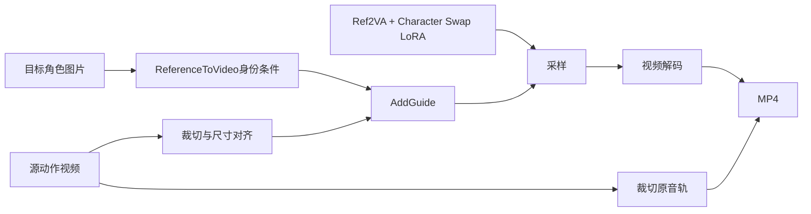

# MiniMax H3 BFS Character Swap：人物替换

本地入口：`006 视频生成 / minimaxh3 / BFS-Character-Swap`，服务 http://127.0.0.1:8188 。两套界面JSON及对应 `api/` JSON已保存；本地生成结果和运行证据见 `results/h3_character_swap/`。

## 本地环境迁移核验（2026-10-14）

已核对当前本机 http://127.0.0.1:8188 的实际容器挂载，并同步整套01–04工作流。文件原先已与项目版本一致，此次再次确认完整部署；无需重启或重复下载模型。

- 本地工作流目录：`/media/wwhvw/备份/comfyui/comfyui-ecosystem/workflows/006 视频生成/minimaxh3/BFS-Character-Swap/`。
- 输入目录：`/media/wwhvw/备份/comfyui/assets/`。7个所需输入文件全部存在；03/04共同读取独立原创角色PNG及各自24fps动作片段。
- 模型目录：`/media/wwhvw/A63032EE3032C559/comfyui-docker/storage-models/models/`。4个模型/LoRA选择均被当前服务识别，正式Character Swap LoRA的SHA-256校验通过。
- 这些工作流、素材和模型均位于持久挂载目录，不依赖本项目目录或临时custom_nodes目录；本套不需要新增自定义节点。

界面刷新工作流列表后进入 `006 视频生成 / minimaxh3 / BFS-Character-Swap`，本轮独立角色图测试选择03或04。03倒挂迁移有效，04仍保留实际复杂镜头失败结果，迁移不会改变测试质量结论。

重新同步与核验：`python3 scripts/deploy_h3_character_swap_local.py`。迁移清单位于项目 `results/h3_character_swap_local_deployment/deployment_manifest.json`。

## 推荐：同一独立角色图对两个视频做迁移（03/04）

03/04共用一张独立生成的原创全身PNG：橙色短发、青绿长裤连体运动服、橙色腰线、白橙鞋。**两套LoadImage读取同一文件** `h3_bfs_original_teal_character_20261014.png`，不是视频首帧；角色图由image_gen独立生成，复制到ComfyUI input和项目references。

| 工作流 | 动作源与片段 | 实际结果 | 服务端秒数 |
| --- | --- | --- | --- |
| 03_独立角色图迁移_Aerial倒挂_124帧 | Aerial Invert原第5秒起，60fps先转24fps | 腾空/翻转/倒挂与服装迁移生效；原文字消失，局部背景重绘 | 386.832 |
| 04_同一独立角色图迁移_角色展示视频_124帧 | 4fa2a802…原前5.17秒，24fps | 人物坐姿换角有效；背景变灰、极近景改构图、翼部特写异常人体、尾巴残留，整段质量不合格 | 310.901 |

两组都已在ComfyUI执行完成，输出1024×576、124帧、24fps、约5.17秒并保留源音轨。共用同一角色提示词、seed20261014、16步er_sde/simple、CFG1、shift12/3、LoRA强度1、参考match；没有额外节点或权重安装。源视频只通过AddGuide供动作，身份只通过Picture1供给。

预处理片段为 `h3_bfs_pole_invert_5s_24fps.mp4` / `h3_bfs_character_showcase_0s_24fps.mp4`；原视频保持不变。LoadVideo载入预处理片段，Video Slice从其0秒开始。更换不同帧率源先转换24fps。换人物只改LoadImage和身份外观提示词即可，两个视频继续共用相同角色图。

[独立角色图](../../references/h3_character_swap_extra/h3_bfs_original_teal_character_20261014.png)，[测试配置](../../results/h3_character_swap_extra/测试配置与用途.md)，[两组结果及并排视频](../../results/h3_character_swap_extra/同一角色图两视频迁移测试报告.md)。ComfyUI返回success只说明执行完成，不等同于视觉质量通过；04应保留为困难镜头失败案例。

以下01/02为已保存的另一组测试，参数和结果保持原样；本轮独立图片测试请使用03/04。

## 功能与作用

[原帖子](https://www.reddit.com/r/StableDiffusion/comments/1x4jh3c/character_swap_minimax_h3_bfs_collection/)发布的是人物替换LoRA：将引导视频中的主要人物替换为参考图人物，尝试保留动作、姿态、表情、视线、镜头和场景。替换范围包括头部、发型、身体、比例和衣服；Head Swap是另一个偏头部替换的LoRA。本次不混用Head Swap。

核心是两条条件链：



1. **目标角色图** → `MiniMaxH3ReferenceToVideo`，提示词以 `body_swap:` 开头，用 `<Picture 1>` 绑定目标人物。图像进入Qwen3-VL视觉文本编码以及H3 VAE参考编码。
2. **动作源视频** → 截取、取帧、对齐尺寸 → `MiniMaxH3AddGuide(frame_idx=0)`。它把视频编码为与输出时空网格对齐的Guide潜变量条件。源视频没有连接原生 `ref_videos`；这是[作者推荐的用法](https://huggingface.co/Alissonerdx/Minimax-H3-ComfyUI/blob/main/docs/character-swap.md)。

Guide是采样条件，不是视频像素锁。人物与场景都会由扩散模型重新生成，因此背景不保证逐像素保留。本次不添加分割遮罩与原图拼回，避免对换衣服、发型和身体轮廓做额外裁切。

BFS Planner用于长视频分镜、单镜头提示词、目标选择、遮罩、裁切与拼回、镜头连续历史及自动逐镜头处理；对本次单人物短片可省略。作者发布的LoRA仍属实验模型，尤其要检查侧脸、快速运动、遮挡、手指、局部面部相似度及跨帧身份变化。多人替换不是已保证的功能。

作者仓库还包含其他独立用途的LoRA，不能仅凭“BFS Collection”把它们视为本工作流的依赖：Character Swap以 `body_swap:` 做整个人物替换；Head Swap以 `head_swap:` 偏重头部替换；LMS用于引导视频的锐度/细节增强；Style Transfer以 `style_transfer:` 改变画风；VFX Edit以 `vfx_edit:` 做提示词驱动的视频编辑；Live Wallpaper偏参考图动画化。本次只安装和测试Character Swap，其他功能是[作者模型目录](https://huggingface.co/Alissonerdx/Minimax-H3-ComfyUI)的用途说明。

## 节点与模型

| 本次使用的节点 | 来源与作用 | 本机状态 |
| --- | --- | --- |
| UNETLoader / CLIPLoader / VAELoader | ComfyUI核心，加载H3 Ref2VA、匹配32B编码器、视频VAE | 已有，复用 |
| LoraLoaderModelOnly | 核心，叠加正式版Character Swap权重，strength=1 | 已有节点，新增LoRA文件 |
| LoadImage | 核心，载入目标角色图 | 已有 |
| LoadVideo / Video Slice / GetVideoComponents | 核心，载入源视频、裁切画面与音轨、分离组件 | 已有 |
| ImageFromBatch / ImageScale | 核心，严格截取124帧、等比居中裁切到576×1024 | 已有 |
| MiniMaxH3ReferenceToVideo / MiniMaxH3AddGuide | 核心，提供身份参考及对齐视频潜变量条件 | 已有 |
| MiniMaxH3SigmaShift | 核心，视频/音频sigma shift=12/3 | 已有 |
| RandomNoise / KSamplerSelect / BasicScheduler / BasicGuider / SamplerCustomAdvanced | 核心，固定种子、16步er_sde/simple、CFG1，采样AV latent | 已有 |
| LTXVSeparateAVLatent / VAEDecode | 核心，分离视频latent并解码 | 已有 |
| CreateVideo / SaveVideo | 核心，输出24fps MP4，复用源音轨 | 已有 |

**本次新增自定义节点：0个。** `MarkdownNote`是前端说明节点，不参与推理。

新增正式LoRA（不是WIP）：`models/loras/minimaxh3/minimax_h3_character_swap_v1.0_ref2va_r64_gl.safetensors`，620,286,056字节，SHA-256 `643a3fe63646fee5aebb181a7e1c9f8a1feb5f472709f37e22eeec290cbb75e3`，下载锁定作者仓库revision `83bf3a9a748319f17b3efc30d9bf10d31286ad06`。模型安装清单见 `results/h3_character_swap/install_manifest.json`。

复用本机配置：

```text
UNET: minmaxh3/diffusion_models/minimax_h3_ref2va_pruned_int8_convrot.safetensors
CLIP: text_encoders/qwen3vl_32b_minimax_h3_int8_convrot.safetensors（type=minimax）
VAE:  vae/minimax_h3_video_vae_int8_convrot.safetensors
```

H3匹配的32B编码器和Planner自动描述所用的4B编码器承担不同任务，不能互换。本次没有自动描述分支，也不需要另外下载4B模型、音频VAE或Turbo权重。

## 如果要加载作者完整版工作流

[原版JSON](https://huggingface.co/Alissonerdx/Minimax-H3-ComfyUI/blob/main/workflows/minimax_h3_character_swap_workflow.json)已保留在 `references/h3_character_swap/upstream_workflow.json`。它需要更多附加组件，和这两套本地原生版区别如下：

| 组件 | 原版用途 | 是否为人物替换核心必需 |
| --- | --- | --- |
| [ComfyUI-BFSNodes](https://github.com/alisson-anjos/ComfyUI-BFSNodes) | BFSShotPlanner、BFSShotUnpack、BFSShotH3ConditioningSimple、BFSShotRepack、BFSShotJoin，分镜、条件、串联与对比 | 原版JSON需要；原生单镜头版可省略 |
| [ComfyUI-KJNodes](https://github.com/kijai/ComfyUI-KJNodes) | SetNode/GetNode无线连线；MiniMaxChunkFeedForward可选内存优化 | 不是核心必需 |
| [ComfyUI-RMBG](https://github.com/1038lab/ComfyUI-RMBG) | BiRefNetRMBG去参考图背景及其模型 | 不是核心必需 |
| [ComfyUI-VideoHelperSuite](https://github.com/Kosinkadink/ComfyUI-VideoHelperSuite) | VHS_VideoCombine保存预览结果 | 可用原生CreateVideo/SaveVideo替代 |
| Fearnworks / SolAttnPatch | MiniMaxLowVRAMAttention及实验attention优化；发布图中处于旁路状态 | 未启用时不是推理必需 |
| Ref2VA DMD 8步Turbo、Qwen3-VL4B描述模型、音频VAE | 原作者8步加速、自动角色描述及音频选项 | 此次16步基础版不需要 |

本机已有BFS旧版，缺少发布图使用的 `BFSShotH3ConditioningSimple`。直接导入作者JSON仍需更新BFS；本次未整体更新它或ComfyUI，避免影响现有工作流。本地原生版不依赖这一节点。

## 两段参考视频的Demo配置

| 工作流 | 动作、背景、原音轨 | 目标角色外观 |
| --- | --- | --- |
| 01_c2角色替换樱花舞蹈_原生AddGuide_124帧 | 舞蹈5.mp4 | c2.mp4首帧：高马尾、蓝色职业套装、黑色丝袜的3D人物 |
| 02_舞蹈角色替换c2_原生AddGuide_124帧 | c2.mp4 | 舞蹈5.mp4首帧：长棕发、米白短上衣、灰紫色裤装的写实人物 |

视频均来自用户给定路径 `/media/wwhvw/备份/comfyui/assets/`，都是24fps；原视频保留不变。首帧参考保存为 `h3_bfs_c2_character.png` / `h3_bfs_dance_character.png`，同时备份在项目 `references/h3_character_swap/`。其中舞蹈首帧没有脚部信息，不能保证02补出的鞋子符合原人物设计。

每套输出576×1024、124帧、24fps、约5.17秒；16步er_sde/simple、CFG1、shift12/3、seed20261014、参考预算match，LoRA强度1。两个方向有风格差异，不是同一个任务的参数对照。作者原版为8步Turbo/Euler，这里是复用基础模型的本机测试配方，不宣称逐项复刻或最佳质量。

舞蹈源720×1280为严格9:16；c2源768×1376略有差异，对齐时按等比居中裁切，损失约4个原视频纵向像素。源音轨同步裁切后放入MP4，**没有声音克隆，也没有把音频交给生成模型作为条件**。

## 使用和调整

在侧栏打开01或02，必要时按 `.` 适应整个节点图。替换“目标角色外观”LoadImage与“源动作视频”LoadVideo。目标图片更改时，一起修改 `body_swap:` 提示词里的具体外观；源视频只提供动作和场景。清晰、无遮挡、全身参考更容易表达完整服装结构。

- 时长：同步修改 Video Slice.duration、ImageFromBatch.length 和 ReferenceToVideo.length。帧数用 `17n+5`，例如124、141、158；秒数=帧数/24。一次先做约5秒，再逐步增加，作者推荐单镜头不超过15秒。
- 起点：调整Video Slice.start_time，画面和原音轨会一起移动；原音轨来源仍为GetVideoComponents。
- 分辨率：同时改Guide ImageScale与ReferenceToVideo的宽高，均用32倍数；避免拉伸，crop=center会裁掉少量边缘。
- 帧率：两套当前固定24fps。更换不同帧率素材时先转为24fps；不能只改最终CreateVideo.fps，否则会影响动作速度和音画同步。
- 质量：可改seed、LoRA强度、步数或ref_image_size=max，但max增加采样token与耗时，不能保证改善脸部。

命令行重建、执行（先确认ComfyUI空闲和LoRA已安装）：

```bash
python3 scripts/build_h3_character_swap.py
python3 scripts/run_h3_character_swap.py --only 01
python3 scripts/run_h3_character_swap.py --only 02
```

输出：`/media/wwhvw/备份/comfyui/output/h3_character_swap/`；每个测试保存实际API、服务端history、MP4及ffprobe信息。测试结论和耗时见[功能分析与本地测试报告](../../results/h3_character_swap/功能分析与本地测试报告.md)。

[Character Swap权重许可证](https://huggingface.co/Alissonerdx/Minimax-H3-ComfyUI/blob/main/LICENSE_CHARACTER_SWAP.md)单独适用，已在references中保留；与其他LoRA、底模、节点的许可证分别判断。
